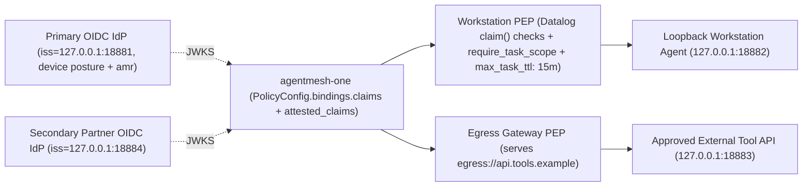

# Device Posture Attestation, Workload Isolation & Gateway Provenance Demo

A self-contained, zero-Docker walkthrough of the enterprise compliance controls
described in
[`site/content/docs/guides/enterprise-posture-compliance.md`](../../../site/content/docs/guides/enterprise-posture-compliance.md).
Everything runs locally on `127.0.0.1` against real `agentmesh-one` and
`agentmesh-node` binaries with **zero extra CLI claim flags**—all OIDC claim
extraction and issuer pinning is declared directly in [`policy.json`](policy.json).

## Topology



## What the script demonstrates

1. **Act 1 — Structural Anti-Spoofing & Issuer Pinning**:
   * An unmanaged mobile device declares `device.trust_tier: high` in
     [`node-spoof.yaml`](node-spoof.yaml). Because `label(k, v)` and
     `claim(k, v)` are separate Biscuit predicates, node labels can never
     satisfy `PolicyBinding.claims` or `claim()` checks (`403`).
   * A secondary trusted partner IdP emitting identical workstation posture
     claims is also rejected (`403`) because `PolicyBinding.claims` pins
     `"iss"` to the primary corporate IdP.
2. **Act 2 — Trusted Posture, Multi-Valued `amr`, Sealed TAR & Provenance**:
   A fully managed, high-trust mobile identity (`amr: ["hwk", "mfa"]`)
   exchanges its OIDC JWT via RFC 8693 `/oauth/token` with a 10-minute sealed
   `TaskAuthorizationRule` (`tar_block`). Both router `/ingress/...` and Envoy
   HTTP `/ext_authz/...` allow the request, strip caller-spoofed `X-Mesh-*`
   headers, and stamp verified `X-Mesh-Principal`, `X-Mesh-Claims`,
   `X-Mesh-Actor-Node`, `X-Mesh-Origin`, and `X-Mesh-Task` headers.
3. **Act 3 — Standing Credentials, Wrong Issuer & Lower-Trust Devices Refused**:
   The same high-trust mobile device *without* a TAR (`require_task_scope`),
   a partner-IdP mobile token, a work-profile mobile device, and an unmanaged
   mobile device are all refused with `403`.
4. **Act 4 — Hard Sandbox-to-Workstation Isolation Wall**: An isolated sandbox
   workload (`workload.env=sandbox`) is blocked with `403` from reaching the
   workstation agent over both `/ingress` and `/ext_authz`.
5. **Act 5 — Scoped Sandbox Egress Through the Gateway**: The isolated sandbox
   reaches the approved external API (`egress://api.tools.example`) using its
   10-minute GET-only Task Biscuit. The gateway injects the upstream credential
   from its secrets directory, forwards attested `X-Mesh-Principal` and
   `X-Mesh-Claims` context, and blocks out-of-scope `POST` mutations with `403`.

## Running

```sh
cd development/examples/device-posture-isolation

# Automated end-to-end check (exits non-zero on any failure)
./run.sh

# Interactive presenter mode (pauses between acts)
./run.sh --interactive
```

Override ports via `CP_PORT`, `IDP_PORT`, `PARTNER_IDP_PORT`, `AGENT_PORT`,
`API_PORT`, `WS_API_PORT`, and `GW_API_PORT` if defaults (`18880`–`18891`) are
in use.
