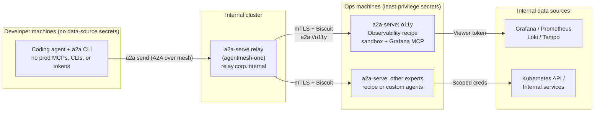

[`a2a-serve`](https://github.com/a2aproject/a2a-serve) turns coding agents such
as Claude Code, OpenCode, GitHub Copilot CLI, or any ACP-compatible agent into a
sandboxed [A2A](https://a2a-protocol.org/) agent that people, chat messengers,
and other agents can call. It runs the agent inside a container or OS sandbox,
enforces per-tool approval policies, isolates or injects credentials, and
connects agents over private networks including an Agent Mesh relay built on
`agentmesh-one` and the [Embedded Go SDK](../go-sdk/).

<video controls playsinline preload="metadata" style="width:100%; border-radius:8px; box-shadow:0 4px 20px rgba(0,0,0,0.4); margin-bottom: 1.5rem;">
  <source src="../../../demo-a2a-serve-recipes.mp4" type="video/mp4">
</video>

The recording walks through the
[Observability Agent example](https://a2aproject.github.io/a2a-serve/examples/04-observability-agent/)
running across an ops machine and developer workstations over an Agent Mesh
relay.

## `a2a-serve` recipes

A [recipe](https://a2aproject.github.io/a2a-serve/guide/recipes/) is a
versioned Git directory that packages a reusable, domain-specific agent. It
bundles `a2a-serve` configuration in `.a2a/config.yaml` (sandbox limits, egress
allowlists, and approval rules), pinned MCP server connectors in `.mcp.json`,
setup metadata for required and optional variables in `.a2a/recipe.yaml`, agent
instructions (`AGENTS.md`, `ENVIRONMENT.md`), and skills. Running
`a2a-serve recipe <url> --name <name>` shows what the agent will execute, flags
risky permissions, prompts only for the connectors and secrets the operator
enables, and writes a ready-to-start agent directory.

Recipes separate what an agent knows how to do from where it runs and who may
call it. Operators layer environment-specific context (service catalogs,
data-source UIDs, dashboards, and SLOs) and network settings on top of the
recipe. When maintainers publish improvements to prompts, skills, or pinned MCP
server versions, running `a2a-serve recipe` inside the agent directory applies
upstream updates while preserving local overrides.

The [Observability Agent](https://a2aproject.github.io/a2a-serve/examples/04-observability-agent/)
is a worked example of this model. Its recipe wires an incident-investigation
specialist to Grafana (Prometheus metrics, Loki logs, Tempo traces, and
Pyroscope profiles) plus optional Kubernetes and GitHub read-only connectors,
under an approval policy that permits read-only telemetry queries and denies
file edits, shell commands, and arbitrary fetches. Teams can deploy that recipe
directly or build custom internal recipes for databases, billing, security, or
release engineering.

## Internal cluster topology with an Agent Mesh relay

In an internal corporate deployment, a single Agent Mesh-backed `a2a-serve`
relay connects developer workstations and ops hosts into one private mesh. No
machine needs inbound firewall ports; every node dials out to the relay and
communicates over authenticated mesh streams using short-lived Biscuit
credentials.



### 1. Run the corporate relay

Platform or ops runs `a2a-serve relay run` inside the internal cluster behind
TLS (or via the `ghcr.io/a2aproject/a2a-serve-relay` container image). The
front process manages `agentmesh-one` and applies the mesh policy
automatically:

```bash
a2a-serve relay run --url https://relay.corp.internal \
  --allow-email '*@corp.example' \
  --google-client-id <id> --google-client-secret env:GOOGLE_CLIENT_SECRET
```

Developers enroll with corporate sign-in, and headless ops machines enroll with
single-use invite tokens (`a2a-serve relay invite o11y`). Operators inspect
active members with `a2a-serve relay members` and cut off an agent or account
mesh-wide with `a2a-serve relay remove <name-or-email>`. See the
[Relays guide](https://a2aproject.github.io/a2a-serve/guide/relays/) for
PostgreSQL storage and container deployments.

### 2. Host expert agents on ops machines

Ops machines run close to production infrastructure and hold the narrow,
read-only credentials required to query internal data sources: for example, a
Grafana Viewer service account token, a Kubernetes `view` ClusterRole
kubeconfig, or a read-only GitHub token.

On the ops machine, an operator bootstraps the observability expert from the
[Observability Agent recipe](https://a2aproject.github.io/a2a-serve/examples/04-observability-agent/),
joins it to the internal relay, scopes sandbox egress to the required internal
hosts, and starts it:

```bash
export GRAFANA_URL=https://grafana.corp.internal
export GRAFANA_SERVICE_ACCOUNT_TOKEN=glsa_...

a2a-serve recipe https://github.com/a2aproject/a2a-serve/tree/main/examples/04-observability-agent/recipe \
  --name o11y \
  --model openrouter/~google/gemini-flash-latest --secret OPENROUTER_API_KEY \
  --egress-allow grafana.corp.internal \
  --private https://relay.corp.internal --network-token env:RELAY_TOKEN

cd o11y && a2a-serve start --detach
```

The operator describes internal services, data-source UIDs, dashboards, and SLOs
in `o11y/ENVIRONMENT.md` (or asks `o11y` to inspect Grafana and draft the file
with `"Learn the environment."`). The same host or dedicated ops nodes can
publish additional recipe-bootstrapped or custom expert agents on the relay,
each with its own sandbox, approval rules, and data-source credentials.

### 3. Call expert agents from developer machines

Developer workstations stay lightweight. Developers only install the
[`a2a` CLI](https://github.com/a2aproject/a2a-cli) (along with its agent skill)
and connect their workspace to the corporate relay. They do not need to set up
MCP connectors, observability skills, database CLIs, or production environment
variables, secrets, and tokens on their laptops.

Once connected to the relay, a developer discovers published experts and adds
`o11y` as a contact:

```bash
a2a-serve peers
a2a-serve contact add o11y
```

From inside a service repository, the developer asks their local coding agent
to investigate a production issue:

```bash
a2a send --stream "Checkout alerts are firing in production. Ask o11y what's going on and check if v2.14.3 caused it."
```

The developer's agent delegates the telemetry lookup to `o11y` over the Agent
Mesh relay using `a2a send`. On the ops machine, `o11y` queries Prometheus
metrics, Loki logs, and Tempo traces, correlates them across sources, and
returns a structured summary with Grafana deeplinks. The developer's coding
agent combines those findings with the local `git` history to identify the
exact code regression, while every production secret stays on the ops host.

## What the walkthrough shows

1. **Cluster and stack startup:** A simulated five-service production stack
   (Grafana LGTM with Prometheus, Loki, and Tempo) and an Agent Mesh-backed
   `a2a-serve` relay start up.
2. **Ops machine bootstrapping:** The operator runs `a2a-serve recipe` against
   the Observability Agent recipe with a read-only Grafana Viewer token, joins
   the relay as `o11y`, and lets the agent discover the environment.
3. **Thin developer machines:** Developer tabs (`dev1`, `dev2`) join the relay
   with an empty `.mcp.json` and no Grafana credentials—only `a2a` CLI and its
   skill—discover `o11y` via `a2a-serve peers`, and check baseline service
   health.
4. **Cross-agent incident investigation:** After injecting a checkout outage,
   the developer's agent calls `o11y` over Agent Mesh, receives correlated
   metric, log, and trace evidence, and cross-references `checkout-service`
   `v2.14.3` to pinpoint the root cause.

## Further reading

- [Observability Agent example (`a2a-serve`)](https://a2aproject.github.io/a2a-serve/examples/04-observability-agent/)
- [`a2a-serve` Recipes guide](https://a2aproject.github.io/a2a-serve/guide/recipes/)
- [How `a2a-serve` uses Agent Mesh](https://a2aproject.github.io/a2a-serve/advanced/agent-mesh/)
- [Exposing A2A agents on Agent Mesh](../exposing-services/#a2a-agents)
- [A2A Chat use case](../../use-cases/chat-a2a/)
- [Embedded Go SDK (`meshnet`)](../go-sdk/)
