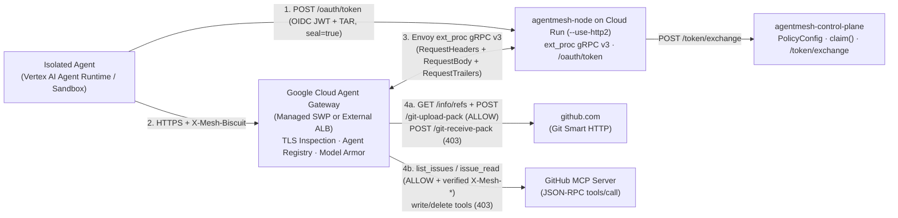

You can keep **Google Cloud Agent Gateway** in the L7 data path for TLS
inspection, Agent Registry, Model Armor, and Cloud Logging while plugging
`agentmesh-node` into its **Service Extensions** delegation hook
(`AuthzExtension` with `wireFormat: EXT_PROC_GRPC` and `AuthzPolicy` with
`policyProfile: CONTENT_AUTHZ`, `action: CUSTOM`).

This lets you enforce short-lived, cryptographically sealed
**Task Authorization Rules (`tar_block`)** and IdP-attested `claim(k, v)`
Biscuit facts on unmodified HTTP, Git Smart HTTP, and MCP traffic—without
building a parallel gateway or handing standing SaaS credentials to isolated
agents.

The full runnable deployment and verification bundle lives in
[`development/examples/gcp-agent-gateway/`](https://github.com/google/agentmesh/tree/main/development/examples/gcp-agent-gateway).

---

## How the pieces fit



### Separation of responsibilities

| Layer | Owned by Google Cloud Agent Gateway | Owned by `agentmesh-node` Service Extension |
|---|---|---|
| **Network & TLS** | Terminates egress TLS, enforces Agent Registry allowlists, runs Model Armor / DLP, and writes `agentGatewayInfo` logs. | Runs as an HTTP/2 gRPC callout (`--use-http2`) behind `AuthzExtension` (or `ProducerExtension` / `ExtensionBinding`). |
| **Task scoping** | Streams request headers, JSON-RPC bodies (`BUFFERED` or `FULL_DUPLEX_STREAMED`), and response events to `ext_proc`. | Verifies Block 0 IdP `claim(k, v)` facts, Datalog RBAC, `require_task_scope: true`, `max_task_ttl: 15m`, and sealed `tar_block` intersections (`allowed_methods`, `allowed_paths`, `allowed_tools`). |
| **Provenance & credentials** | Forwards allowed traffic to upstream destinations and applies returned `HeaderMutation`s. | Strips caller-spoofed `X-Mesh-*` / `X-Peer-Id` headers, stamps verified `X-Mesh-Principal`, `X-Mesh-Claims`, `X-Mesh-Roles`, `X-Mesh-Actor-Node`, `X-Mesh-Task`, and `X-Mesh-Origin`, and injects brokered `Authorization` headers (`PolicyConfig.egress` or MCP `target_auth_path`) **only after** authorization succeeds. |

---

## How `agentmesh-node` handles unmodified Agent Gateway traffic

Real gateways forward the upstream destination's `:authority` and `:path`
without adding mesh-specific routing headers. `agentmesh-node`'s Envoy server
(`internal/envoy/server.go`, `internal/node/ext_authz.go`) handles this
directly:

1. **Host and path resolution (no `X-Mesh-Target-Service` required):**
   - Strips explicit `:port` suffixes (for example, `github.com:443` or
     `api.githubcopilot.com:443`) before matching.
   - Matches registered URL-backed `mcp` services by host and longest
     segment-boundary path prefix (failing closed with `403` if two MCP
     services tie ambiguously on the same host and prefix).
   - Falls back to control-plane-assigned `egress` destinations (`PolicyConfig.egress`)
     for non-MCP HTTP/Git traffic (for example, `egress://github.com`).
   - Explicit `X-Mesh-Target-Service` headers and `/mesh/<scheme>/<name>/...`
     paths continue to take precedence when present.
2. **Selective body inspection without buffering Git packfiles:**
   - For `POST` requests resolved to an `mcp://` service (even when mounted at
     `/` rather than `/mcp`), Phase 1 (`RequestHeaders`) validates the Biscuit,
     claims, and service grant without releasing backend credentials, then
     requests `RequestBodyMode: BUFFERED` to inspect JSON-RPC `tools/call`
     `params.name` in Phase 2 (`RequestBody`).
   - For non-MCP `POST` requests (such as Git Smart HTTP
     `POST /<org>/<repo>.git/git-upload-pack`), Phase 1 decides immediately on
     method and path with zero body buffering so large packfiles stream
     untouched.
3. **`BUFFERED` and `FULL_DUPLEX_STREAMED` (`CONTENT_AUTHZ`) body modes (fail-closed on half-duplex `STREAMED`):**
   - Supports single-frame `BUFFERED` bodies (or `allow_mode_override: true`) and
     Envoy's `FULL_DUPLEX_STREAMED` mode used by Google Cloud Agent Gateway
     `CONTENT_AUTHZ` (holding all MCP body chunks silently until `end_of_stream`
     or `RequestTrailers` passes `allowed_tools`, then echoing allowed request
     and response bodies via `StreamedBodyResponse`).
   - Rejects partial half-duplex `STREAMED` MCP body chunks fail-closed with
     HTTP `403` on the first chunk, because answering `CONTINUE` on an
     intermediate `STREAMED` chunk would release unverified bytes upstream before
     the full JSON-RPC call is inspected.
   - Emits strictly lowercase HTTP/2 header names in `HeaderMutation` and caps
     buffered JSON-RPC inspection at 1 MiB (`MaxHTTPBodyBytes`), failing closed
     with HTTP `413 Payload Too Large` on overflow.

---

## Example policy: read-only Git clone + read-only GitHub MCP issues

Coarse domain+verb proxies cannot allow `git clone` (which requires
`POST /<org>/<repo>.git/git-upload-pack`) without also opening `git push`
(`POST /<org>/<repo>.git/git-receive-pack`) and arbitrary repositories, nor can
they distinguish read-only vs. mutating MCP tools on `POST /mcp`.

With a single 10-minute sealed `TaskAuthorizationRule` minted via RFC 8693
`POST /oauth/token` (`seal=true`):

```json
{
  "name": "tasks/gcp-agw-github-readonly",
  "display_name": "Clone google/agentmesh + Read GitHub Issues Only",
  "expire_time": "2026-11-27T12:30:00Z",
  "rules": [
    {
      "description": "Allow read-only Git Smart HTTP clone of google/agentmesh.git only",
      "allowed_services": ["egress://github.com"],
      "operation": {
        "allowed_methods": ["GET", "POST"],
        "allowed_paths": [
          "/google/agentmesh.git/info/refs",
          "/google/agentmesh.git/git-upload-pack"
        ]
      }
    },
    {
      "description": "Allow read-only GitHub MCP issue tools only",
      "allowed_services": ["mcp://github"],
      "operation": {
        "allowed_tools": ["list_issues", "issue_read", "search_issues"]
      }
    }
  ]
}
```

| Request through Agent Gateway | Decision | Enforced By |
|---|---|---|
| `GET github.com/google/agentmesh.git/info/refs?service=git-upload-pack` | **200 Allow** | `ext_proc` Phase 1 (`egress://github.com`) |
| `POST github.com/google/agentmesh.git/git-upload-pack` | **200 Allow** (no body buffering) | `ext_proc` Phase 1 (`egress://github.com`) |
| `POST github.com/google/agentmesh.git/git-receive-pack` (`git push`) | **403 Deny** | `ext_proc` Phase 1 (`allowed_paths`) |
| `GET github.com/kubernetes/kubernetes.git/info/refs` | **403 Deny** | `ext_proc` Phase 1 (`allowed_paths`) |
| `HTTP CONNECT` tunnel bypass | **403 Deny** | `api/tar.go` fail-closed `CONNECT` check |
| `POST /mcp` `tools/call` `list_issues`, `issue_read`, `search_issues` | **200 Allow** + spoofed headers stripped | `ext_proc` Phase 2 (`mcp://github`) |
| `POST /mcp` `tools/call` `issue_write`, `create_pull_request`, `push_files`, `delete_repository` | **403 Deny** (before backend or secret injection) | `ext_proc` Phase 2 (`allowed_tools`) |
| Unattenuated standing Biscuit (no TAR) or TTL > 15m | **403 Deny** | `require_task_scope: true`, `max_task_ttl: 15m` |

---

## Google Cloud Agent Gateway configuration

### 1. `agentmesh-node` policy & config

Seed `PolicyConfig` with `egress` destinations assigned to the gateway PEP
(`served_by: ["role=agent-gateway-pep"]`), and configure `agentmesh-one` /
`agentmesh-control-plane` with `--workload-issuer` including your Google Cloud
**Agent Identity** Workload Identity Pool OIDC issuer so Vertex AI Agent
Runtime `AGENT_IDENTITY` JWTs verify via standard OIDC Discovery:

- **Organization-scoped projects:**
  `https://sts.googleapis.com/v1/organizations/<ORG_ID>/locations/global/workloadIdentityPools/agents.global.org-<ORG_ID>.system.id.goog`
- **Standalone projects (no organization):**
  `https://sts.googleapis.com/v1/projects/<PROJECT_NUMBER>/locations/global/workloadIdentityPools/agents.global.project-<PROJECT_NUMBER>.system.id.goog`

Configure `agentmesh-node.yaml` with `require_task_scope: true`,
`max_task_ttl: 15m`, the allowed issuer check, and the MCP target URL (plus
optional `target_auth_path` mounted from Secret Manager):

```yaml
version: "v1alpha1"
labels:
  role: agent-gateway-pep
attenuation:
  checks:
    - 'check if claim("iss", "https://accounts.google.com") or claim("iss", "https://sts.googleapis.com/v1/organizations/<ORG_ID>/locations/global/workloadIdentityPools/agents.global.org-<ORG_ID>.system.id.goog");'
  require_task_scope: true
  max_task_ttl: 15m
services:
  - type: mcp
    name: github
    description: "GitHub MCP server governed by Agent Gateway ext_proc + TAR"
    target_url: "https://api.githubcopilot.com/mcp"
    # Optional (requires --socket-path or mTLS --tls-ca trusted transport):
    # inject a read-only token ONLY after tool authz succeeds:
    # target_auth_path: "/secrets/github-ro-token"
```

> **Note:** Returning an upstream `Authorization` header (`PolicyConfig.egress`
> credential brokering or MCP `target_auth_path`) requires a trusted gateway
> transport (`--socket-path` or client-certificate mTLS via `--tls-ca`). On
> Cloud Run, omit `target_auth_path` (the backend holds its own upstream secret
> and trusts the gateway-stamped `X-Mesh-*` headers) or terminate mTLS at the
> PEP with `--tls-ca`.

Deploy the PEP container to Cloud Run with `--use-http2` (HTTP/2 `h2c` is
enabled natively on `agentmesh-node`'s `--bind-addr`).

### 2. Managed Agent Gateway (`AGENT_TO_ANYWHERE`) resources

```yaml
# agent-gateway.yaml
name: agentmesh-egress-gw
protocols:
  - MCP
googleManaged:
  governedAccessPath: AGENT_TO_ANYWHERE
```

```yaml
# authz-extension.yaml
# Omit forwardHeaders so Google Cloud Service Extensions forwards all client
# headers (including :authority, :method, :path, Content-Type, Authorization,
# and X-Mesh-Biscuit). Specifying a partial forwardHeaders list drops
# :authority/Host and prevents host-based target resolution.
name: agentmesh-tar-ext
service: <CLOUD_RUN_PEP_HOST>
authority: <CLOUD_RUN_PEP_HOST>
wireFormat: EXT_PROC_GRPC
failOpen: false
timeout: "1.0s"
loadBalancingScheme: LOAD_BALANCING_SCHEME_UNSPECIFIED
```

```yaml
# content-authz-policy.yaml
name: agentmesh-tar-content-authz
target:
  loadBalancingScheme: LOAD_BALANCING_SCHEME_UNSPECIFIED
  resources:
    - "projects/PROJECT_ID/locations/us-central1/agentGateways/agentmesh-egress-gw"
action: CUSTOM
policyProfile: CONTENT_AUTHZ
httpRules:
  - to:
      operations:
        - hosts:
            - exact: "github.com"
            - exact: "<MCP_BACKEND_HOST>"
          paths:
            - prefix: "/"
customProvider:
  authzExtension:
    resources:
      - "projects/PROJECT_ID/locations/us-central1/authzExtensions/agentmesh-tar-ext"
```

Import all three declaratively with `gcloud beta`:

```sh
gcloud beta network-services agent-gateways import agentmesh-egress-gw \
  --source=agent-gateway.yaml --location=us-central1 --project=PROJECT_ID

gcloud beta service-extensions authz-extensions import agentmesh-tar-ext \
  --source=authz-extension.yaml --location=us-central1 --project=PROJECT_ID

gcloud beta network-security authz-policies import agentmesh-tar-content-authz \
  --source=content-authz-policy.yaml --location=us-central1 --project=PROJECT_ID
```

---

## Two runnable topologies

[`development/examples/gcp-agent-gateway/`](https://github.com/google/agentmesh/tree/main/development/examples/gcp-agent-gateway)
ships idempotent scripts for both:

1. **Managed Agent Gateway + Vertex AI Agent Runtime (`deploy_managed_agw.sh` + `agent_runtime/deploy_agent.py`):**
   Provisions a Google-managed `AgentGateway` (`AGENT_TO_ANYWHERE`), attaches
   `agentmesh-node` on Cloud Run via `AuthzExtension` (`EXT_PROC_GRPC`) and
   `AuthzPolicy` (`CONTENT_AUTHZ`), and deploys an ADK agent with
   `identity_type: AGENT_IDENTITY` and `agent_gateway_config` to run the live
   allow/deny matrix against `github.com` and live `api.github.com`.
2. **Edge Agent Gateway / Regional External ALB (`deploy_edge_alb.sh` + `verify_edge_alb.sh`):**
   Fronts the same `agentmesh-node` Cloud Run PEP behind a Regional External
   ALB (`EXTERNAL_MANAGED`) with `AuthzExtension` (`EXT_PROC_GRPC`) and
   `AuthzPolicy` (`CONTENT_AUTHZ`), allowing direct real `git clone`,
   `git push`, and MCP verification from any developer terminal.

## Logs and production hardening

- Every `ext_proc` decision emits an `Audit Traceability` log line on
  `agentmesh-node` (`protocol: "ext_authz"`, `decision`, `mcp_tool`, `task`,
  `principal`, `claims`), and every `/oauth/token` exchange emits a
  `Border Crossing` log line on the control plane.
- Restrict `ALLOWED_AUDIENCE` strictly to your workload audience (do not keep
  the developer CLI client ID in production) and narrow `PolicyBinding.members`
  and `PolicyBinding.claims` to approved workload identities.
- When deploying into a private VPC, set `--ingress=internal-and-cloud-load-balancing`
  on Cloud Run, front `agentmesh-node` with a Regional Internal ALB, and attach
  a VPC `networkAttachment` + `dnsPeeringConfig` to the `AgentGateway` (or
  publish `agentmesh-node` behind a PSC Service Attachment as a
  `ProducerExtension` + `ExtensionBinding`).
- Run `PROJECT_ID=<id> REGION=us-central1 ./cleanup.sh` to tear down all
  example resources.
