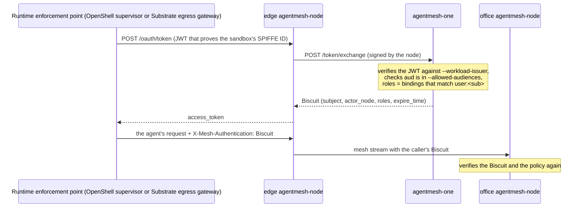

[NVIDIA OpenShell](https://github.com/NVIDIA/OpenShell) and
[Agent Substrate](https://github.com/agent-substrate/substrate) run agents in
isolated workloads. OpenShell runs an agent in a sandbox. Substrate runs an
agent in an actor. Both runtimes keep the credentials and the egress rules of
the agent outside the workload.

This tutorial puts workloads of both runtimes on one Agent Mesh. Each
workload is a mesh member with its own identity. One policy says what each
identity can call. A workload in one cluster can reach a tool that a node
publishes in the other cluster. To move a workload to the other runtime, run
the same image there and change one line of the policy.

The tutorial covers four deployments and the paths between them:

|  | Kubernetes you manage | GKE |
|---|---|---|
| **OpenShell** | [Section 3](#3-openshell-on-kubernetes-you-manage) | [Section 4](#4-openshell-on-gke) |
| **Substrate** | [Section 5](#5-substrate-on-kubernetes-you-manage) | [Section 6](#6-substrate-on-gke) |

kind represents Kubernetes that you manage. Every command in this tutorial
ran on the versions in [Section 1.3](#13-versions).

## 1. How it works

### 1.1 Three products, three meanings of "gateway"

| Role | OpenShell | Substrate | Agent Mesh |
|---|---|---|---|
| Control plane: API, lifecycle, policy, credentials | **gateway** (`ghcr.io/nvidia/openshell/gateway`). It carries no agent traffic. | `ateapi` and `atecontroller` | `agentmesh-one` (control plane and router) |
| Per-workload enforcement point: DNS, egress rules, credential injection | **supervisor**, one per sandbox | `atunnel` in the worker pod and the shared `atenet-egress` gateway | `agentmesh-node` |
| Workload | sandbox, with networking off | actor in gVisor or a micro-VM | any client of a node |

Agent Mesh connects to the enforcement point of each runtime. The allowlist
of the runtime contains one external endpoint, the edge `agentmesh-node`. The
mesh decides which tools, models and destinations the workload can reach, and
knows the identity under which the workload calls them. The data path of the
runtime does not change.

### 1.2 How a sandbox becomes a mesh member



- The workload holds no credential. The enforcement point of the runtime gets
  the Biscuit and attaches it to each request. The agent sees one
  unauthenticated MCP endpoint.
- The `--workload-issuer` and `--allowed-audiences` flags on the control plane
  make the trust decision. The control plane authenticates every identity
  that the issuer signs for that audience. Only the `bindings` define what
  the identity can do.
- A binding member is `user:<sub>`. The member can contain one `*`, at the
  start or at the end. For example,
  `user:spiffe://openshell.local/openshell/sandbox/*` binds every sandbox of
  one OpenShell gateway.
- A node publishes a service only when its role lists the service in
  `allowed_publish`.
- The serving node verifies the Biscuit again. A Biscuit is bound to the node
  that obtained it. A copy of the Biscuit does not work from another node.
- The Biscuit carries the roles that the control plane gave it at mint time.
  The serving node allows a call when the roles of the Biscuit or the current
  policy grant the call. A new binding takes effect at the next policy sync
  of the nodes, within seconds. A removed binding takes effect when the
  runtime replaces the cached Biscuit of the caller. For a Substrate actor,
  this takes up to 60 s (the cache of the provider). For an OpenShell sandbox
  at `0.1.4`, the measured time is about 3 minutes, and
  `cache_ttl_seconds: 60` in the profile did not shorten it.

| | OpenShell sandbox | Substrate actor |
|---|---|---|
| Identity | SPIRE JWT-SVID, `spiffe://openshell.local/openshell/sandbox/<id>` | actor X.509 certificate, `spiffe://substrate-actor.local/actor/<atespace>/<name>` |
| Who exchanges it | the supervisor, with a provider profile (`token_grant`, `jwt-spiffe` assertion, RFC 7523) | the egress gateway, through a `CredentialProvider` that answers `ate-secret://agentmesh/mesh/biscuit` |
| Where the mesh endpoint is allowed | `NetworkEndpoint` in the sandbox policy and `allowed_ips` in the provider profile | `EgressPolicy.rules[].http.effects.replaceHeaders[].credentialUri` |
| What the agent sees | `http://host.openshell.internal:8090/mcp` (Docker) or the edge Service (Kubernetes) | `http://edge-node.agentmesh.svc.cluster.local.:8080/mcp` |

### 1.3 Versions

| Component | Version |
|---|---|
| Agent Mesh (`agentmesh-one`, `agentmesh-node`) | `v0.1.1` |
| OpenShell | `0.1.3` (Docker driver), `0.1.4` (Kubernetes driver, Helm chart) |
| Agent Sandbox (`agents.x-k8s.io`) | `v1.0.7` |
| SPIRE (SPIFFE hardened charts) | `0.29.0` (CRDs `0.5.0`) |
| Agent Substrate | `v0.5.0` |
| GKE | `1.36.4`, Dataplane V2 |

### 1.4 The examples

| Directory | Runtime | Driver | Cluster |
|---|---|---|---|
| [`development/examples/openshell-sandbox`](https://github.com/google/agentmesh/tree/main/development/examples/openshell-sandbox) | OpenShell | Docker | none (Docker Compose) |
| [`development/examples/openshell-kubernetes`](https://github.com/google/agentmesh/tree/main/development/examples/openshell-kubernetes) | OpenShell | Kubernetes | kind or GKE |
| [`development/examples/substrate-actor`](https://github.com/google/agentmesh/tree/main/development/examples/substrate-actor) | Substrate | - | kind or GKE |

Each example has an edge node, an office node and a policy. The office node
publishes a calculator as `mcp://calc` and as `mcp://payroll`. The policy
gives the sandbox role access to `mcp://calc` and not to `mcp://payroll`.
`make call` shows the tools that the workload can see. Then it calls `calc`
and calls `payroll`. The expected result is the same in each example:

```text
mcp://calc/add(2, 3) = 5.0
mcp://payroll/add(2, 3) -> refused: ... biscuit: denied by no matching policies
```

## 2. The hub

The hub is one `agentmesh-one`. It is the control plane and the router for
every cluster in this tutorial.

### 2.1 In the cluster

For one cluster, run the hub in the cluster. The examples do this with
`HUB=local`, which is the default. No other step is necessary.

### 2.2 On Cloud Run

For more than one cluster, run the hub at a location that every cluster can
reach. This tutorial uses Cloud Run. Follow the
[Cloud Run guide](/docs/guides/cloud-run/) for the service. Then do these
steps:

1. Create the signing keys and the policy as secrets. You own the keys. The
   control plane installs them from the file and does not rotate them. To
   rotate the keys, edit the secret. The Cloud Run guide has the procedure.

   ```bash
   openssl genpkey -algorithm ed25519 -out ed25519-v1.pem
   openssl genpkey -algorithm ec -pkeyopt ec_paramgen_curve:P-256 -out p256-v1.pem
   cat ed25519-v1.pem p256-v1.pem | gcloud secrets create mesh-signing-keys --data-file=-
   gcloud secrets create mesh-policy --data-file=policy.json
   SA=$(gcloud projects describe <project> --format='value(projectNumber)')-compute@developer.gserviceaccount.com
   for s in mesh-signing-keys mesh-policy; do
     gcloud secrets add-iam-policy-binding "$s" --member="serviceAccount:$SA" --role=roles/secretmanager.secretAccessor
   done
   ```

2. Mount both secrets and pass the issuers of both runtimes. On Cloud Run, a
   list in `--args` needs the `^;^` delimiter:

   ```bash
   gcloud run services update <hub> --region <region> \
     --set-secrets=/etc/agentmesh/keys/signing-keys.pem=mesh-signing-keys:latest,/etc/agentmesh/policy.json=mesh-policy:latest \
     --args="^;^--data-dir=/data;--port=8080;--signing-key-path=/etc/agentmesh/keys/signing-keys.pem;--policy-file=/etc/agentmesh/policy.json;--allowed-audiences=agentmesh;--workload-issuer=<openshell issuer>,<substrate issuer>"
   ```

   Sections 4 and 6 define each issuer. The control plane starts before an
   issuer answers. It accepts the tokens of that issuer after the issuer
   starts to answer.

   To change the policy, run `gcloud secrets versions add mesh-policy
   --data-file=policy.json` and deploy a new revision. For an immediate
   change, `POST /policies` with the admin token. That change does not
   survive a revision.

3. Write the `AGENTMESH_TOKEN` of the hub to `run/join-token` in each example
   directory that you use. Write the `AGENTMESH_ADMIN_TOKEN` to
   `run/admin-token` in the same directories.

A new revision keeps the keys and the policy. The nodes start with
`--bootstrap-token-path`. A node that the new revision does not know enrolls
again automatically.

Give the service a `--timeout` of 600 seconds or less. The WebSocket from a
member to the router lives until the timeout. After a new revision, a member
stays on the old instance until its connection ends. Until then, the two
instances have separate directories.

## 3. OpenShell on Kubernetes you manage

OpenShell runs from its Helm chart. Each sandbox is an `agents.x-k8s.io`
`Sandbox` with a supervisor pod next to it. SPIRE gives the supervisor pod a
SPIFFE identity through one `ClusterSPIFFEID`. The supervisor exchanges that
identity for a Biscuit at the edge node. One chart value
(`provider_spiffe_workload_api_socket_path`) and one provider profile connect
OpenShell to the mesh. The example does not modify OpenShell.

You need `kubectl`, `helm`, `docker`, `kind`, the `openshell` CLI (`0.1.3`
or later), `python3` and `curl`.

```bash
cd development/examples/openshell-kubernetes
make cluster                     # a kind cluster
make up                          # Agent Sandbox, SPIRE, the mesh with the hub in the cluster, OpenShell
make sandbox NAME=demo           # prints spiffe://openshell.local/openshell/sandbox/<id>
make call NAME=demo              # refused: no role binds the identity yet
make bind NAME=demo              # adds the member to the sandbox role and pushes the policy
make call NAME=demo              # calc allowed, payroll refused
make netpol-check NAME=demo      # the workload pod cannot reach the edge node; an unconfined pod can
make rogue                       # a second sandbox, not bound: refused
make unbind NAME=demo            # removes the member; refused within about 3 minutes
make down                        # OpenShell, the mesh, SPIRE
make clean                       # the kind cluster
```

`make bind` edits the `sandbox` binding in `policy.json` and pushes the
policy. To bind every sandbox of this gateway, set the member to
`user:spiffe://openshell.local/openshell/sandbox/*` instead.

Expected output of `make call` after `make bind`:

```text
== tools the mesh offers sandbox demo
  12D3KooWM5k2n5zm…  mcp://calc/add           Return a + b.
  12D3KooWM5k2n5zm…  mcp://calc/multiply      Return a * b.
== mcp://calc, allowed for the sandbox role
mcp://calc/add(2, 3) = 5.0
== mcp://payroll, not in the sandbox role
  (no tool of mcp://payroll is visible to this sandbox; calling the office node directly)
mcp://payroll/add(2, 3) -> refused: auth rejected by 12D3KooWM5k2…: biscuit: denied by no matching policies
```

The hub logs one line for each credential that it mints:

```text
Border Crossing {"endpoint": "/token/exchange", "decision": "allow",
  "subject": "spiffe://openshell.local/openshell/sandbox/2c399868-…", "roles": ["sandbox"]}
```

The CNI must enforce `NetworkPolicy`. `make netpol-check` creates a pod
without a sandbox. It shows that this pod reaches the edge node and that the
workload pod does not.

To run the same example with the Docker driver and no cluster, use
`development/examples/openshell-sandbox` and the
[OpenShell guide](/docs/guides/openshell/).

## 4. OpenShell on GKE

The same example runs on GKE with the hub on Cloud Run. Three items differ
from kind.

**Node image.** The sandbox runtime of OpenShell needs Landlock ABI v3. The
Container-Optimized OS kernel has no `CONFIG_SECURITY_LANDLOCK`. On that
kernel, the workload pod exits with `Landlock ABI probe … kernel lacks
CONFIG_SECURITY_LANDLOCK`. Create the node pool for the sandboxes with
`--image-type UBUNTU_CONTAINERD`.

**Service CIDR.** GKE gives ClusterIPs from `34.118.224.0/20`, which is
outside RFC 1918. The example renders the `allowed_ips` of the provider
profile from the ClusterIP of the edge Service. A wrong list shows in the
supervisor log as `NET:REFUSE … policy_dns_no_valid_address`.

**Issuer.** The hub must fetch the OIDC discovery document and the keys of
SPIRE. Expose the SPIRE OIDC discovery provider on a reserved address. Name
that address as the issuer.

```bash
gcloud container clusters create <cluster> --zone <zone> --enable-dataplane-v2 --num-nodes 2
gcloud container node-pools create ubuntu-pool --cluster <cluster> --zone <zone> \
  --image-type UBUNTU_CONTAINERD --num-nodes 2
gcloud compute addresses create spire-oidc --region <region>
IP=$(gcloud compute addresses describe spire-oidc --region <region> --format='value(address)')

cd development/examples/openshell-kubernetes
export KUBE_CONTEXT=gke_<project>_<zone>_<cluster> OPENSHELL_GATEWAY=openshell-gke
make prereqs OIDC_SERVICE_TYPE=LoadBalancer OIDC_LOAD_BALANCER_IP=$IP JWT_ISSUER=http://$IP
# hub: add http://$IP to --workload-issuer (Section 2.2), then
cp <join token> run/join-token && cp <admin token> run/admin-token
docker build -t <registry>/calc-mcp:v1 ../calc-mcp && docker push <registry>/calc-mcp:v1
docker build -t <registry>/sandbox:v1 -f Dockerfile.sandbox . && docker push <registry>/sandbox:v1
make mesh HUB=https://<hub>.run.app CALC_MCP_IMAGE=<registry>/calc-mcp:v1
make openshell HUB=https://<hub>.run.app SANDBOX_IMAGE=<registry>/sandbox:v1
make sandbox NAME=demo && make bind NAME=demo HUB=https://<hub>.run.app && make call NAME=demo
```

`OPENSHELL_GATEWAY` is the name under which the `openshell` CLI stores the
gateway of this cluster. Use one name per cluster. Each target selects its
own name.

The issuer is plain HTTP on a public address. Any server that answers at
that address can mint identities. Put TLS in front of the issuer before you
use it for more than a test.

`make bind` with `HUB=<url>` pushes the policy to the hub with the admin
token. To keep the change across a revision, also add the policy as a new
version of the `mesh-policy` secret.

The result is the same as in Section 3. The `Border Crossing` line of the
hub is in Cloud Logging.

## 5. Substrate on Kubernetes you manage

The egress gateway of Substrate injects credentials that a
`CredentialProvider` returns. The example runs a provider that answers
`ate-secret://agentmesh/mesh/biscuit` with a Biscuit for the SPIFFE ID of the
calling actor. To get that Biscuit, the provider acts as a workload identity
issuer for the mesh. It signs a JWT for the actor and exchanges the JWT at
the edge node, as the OpenShell supervisor does. The `EgressPolicy` of the
actor lets the actor reach the edge node. The `EgressPolicy` also names the
credential for the `X-Mesh-Authentication` header.

You need `docker`, `kind`, `ko`, `kubectl`, Go, `python3`, and a checkout of
Substrate at `v0.5.0`.

```bash
cd development/examples/substrate-actor
make cluster SUBSTRATE_DIR=~/src/substrate   # kind, Substrate from source, egress gateway pointed at the provider
make up                                      # the mesh with the hub in the cluster, and the provider
make actor NAME=demo                         # an actor with its EgressPolicy
make call NAME=demo                          # tools, calc allowed, payroll refused
make rogue                                   # an actor the policy does not bind: refused
make down                                    # the actors and the agentmesh namespace
make clean                                   # the kind cluster
```

The policy is in `manifests/mesh.yaml.tmpl`. A binding gives the `actor`
role to `user:spiffe://substrate-actor.local/actor/ate-demo-sandbox/demo`. To
admit the rogue actor, add
`user:spiffe://substrate-actor.local/actor/ate-demo-sandbox/rogue` to the
members and run `make policy`.

Expected output of `make call`:

```text
== tools the mesh offers actor demo
  12D3KooWEKsFc3PM…  mcp://calc/add           Return a + b.
  12D3KooWEKsFc3PM…  mcp://calc/multiply      Return a * b.
== mcp://calc, allowed for the actor role
mcp://calc/add(2, 3) = 5.0
== mcp://payroll, not in the actor role
  (no tool of mcp://payroll is visible to this actor; calling the office node directly)
mcp://payroll/add(2, 3) -> refused: auth rejected by 12D3KooWEKsFc3PM…: biscuit: denied by no matching policies
```

Two properties of Substrate `v0.5.0` matter here:

- `--credential-provider` needs the envoy dataplane, which is the default.
- The DNS relay of the actor answers `REFUSED` for a name outside the
  `EgressPolicy`. With `ndots:5` and the musl resolver (Alpine images), the
  resolver expands a relative name with the search list first. Those
  expansions get `REFUSED` and the lookup fails. Use absolute names with a
  trailing dot, for example `edge-node.agentmesh.svc.cluster.local.`. The
  example does this.

### 5.1 With the hub on Cloud Run

With `HUB=<url>`, the hub must fetch the discovery document and the JWKS of
the provider. A kind cluster cannot serve them. The provider signs with a key
that you keep. The two documents are static files at a public URL:

```bash
openssl genpkey -algorithm ec -pkeyopt ec_paramgen_curve:P-256 -out provider-p256.pem
export HUB=https://<hub>.run.app ISSUER=https://storage.googleapis.com/<bucket>/substrate PROVIDER_KEY_PATH=$PWD/provider-p256.pem
make issuer-docs                             # writes run/issuer/.well-known/openid-configuration and run/issuer/keys
gcloud storage cp -r run/issuer/.well-known run/issuer/keys gs://<bucket>/substrate/
# hub: add $ISSUER to --workload-issuer (Section 2.2), then
cp <join token> run/join-token && cp <admin token> run/admin-token
make up && make actor NAME=demo && make call NAME=demo
```

To rotate the key, do these steps. Create a new key. Publish a JWKS with
both keys. Replace the Secret `credential-provider-signing-key`. Then remove
the old key from the JWKS.

## 6. Substrate on GKE

The tooling of Substrate creates the cluster and installs Substrate. The
example adds the mesh. Run these commands in the Substrate checkout:

```bash
cp hack/ate-dev-env.sh.example .ate-dev-env.sh    # set PROJECT_ID, GCE_REGION, CLUSTER_LOCATION, CLUSTER_NAME, KO_DOCKER_REPO
source .ate-dev-env.sh
gcloud auth application-default set-quota-project $PROJECT_ID
go run ./tools/setup-gcp bootstrap                 # APIs, GKE cluster, GCS bucket, IAM (about 8 minutes)
kubectl apply -f <agentmesh>/development/examples/substrate-actor/manifests/namespace.yaml
./hack/install-ate.sh --deploy-ate-system --deploy-demo-sandbox \
  --credential-provider='{"name":"agentmesh","address":"credential-provider.agentmesh.svc:50051"}'
```

The `namespace.yaml` step comes before the install because the egress
gateway resolves the Service of the provider at start. `atenet-egress` stays
`1/3` until the provider runs.

Then run these commands in the example directory, with the hub, the issuer
and the key of Section 5.1:

```bash
cd development/examples/substrate-actor
export KUBE_CONTEXT=gke_<project>_<zone>_<cluster> KO_DOCKER_REPO=<registry>
docker build -t <registry>/calc-mcp:v1 ../calc-mcp && docker push <registry>/calc-mcp:v1
export CALC_MCP_IMAGE=<registry>/calc-mcp:v1
export HUB=https://<hub>.run.app ISSUER=https://storage.googleapis.com/<bucket>/substrate PROVIDER_KEY_PATH=$PWD/provider-p256.pem
cp <join token> run/join-token && cp <admin token> run/admin-token
make up                                      # about 30 s; atenet-egress goes to 3/3
make actor NAME=demo && make call NAME=demo
```

The result is the same as in Section 5. The actor runs in gVisor. On its
first call, it resumes from the golden snapshot of the template.

Two Substrate clusters on one hub present the same actor identities.
`spiffe://substrate-actor.local/actor/<atespace>/<name>` is the trust domain
of Substrate, not of the cluster. Run one Substrate cluster per hub, or use a
different atespace name in each cluster.

## 7. Both runtimes on one mesh

With OpenShell (Section 3 or 4) and Substrate (Section 5 or 6) on the Cloud
Run hub, one policy binds both identities to one role:

```json
{
  "roles": [
    {"name": "mesh:role:node", "allowed_services": ["*"], "allowed_publish": ["*"], "allowed_targets": ["*"], "allowed_labels": ["*"]},
    {"name": "mesh:role:router", "allowed_services": ["*"], "allowed_targets": ["*"]},
    {"name": "sandbox", "allowed_services": ["system://mesh.catalog", "mcp://calc"], "allowed_targets": ["*"]}
  ],
  "bindings": [
    {"role": "sandbox", "members": [
      "user:spiffe://openshell.local/openshell/sandbox/*",
      "user:spiffe://substrate-actor.local/actor/ate-demo-sandbox/demo"
    ]}
  ]
}
```

Push the policy as in Section 2.2. Then, from either side, `make call` lists
two providers of `mcp://calc`, the office node in each cluster. The call
goes to the first provider by peer ID. `PEER=<prefix>` selects one provider:

```bash
cd development/examples/openshell-kubernetes
make call NAME=demo PEER=<peer id of the office node in the Substrate cluster>
```

```text
== tools the mesh offers sandbox demo
  12D3KooWDV7WA57x…  mcp://calc/add           Return a + b.
  12D3KooWJozR2PAJ…  mcp://calc/add           Return a + b.
== mcp://calc, allowed for the sandbox role
  calling provider 12D3KooWJozR2PAJ…
mcp://calc/add(2, 3) = 5.0
== mcp://payroll, not in the sandbox role
  calling provider 12D3KooWJozR2PAJ…
mcp://payroll/add(2, 3) -> refused: auth rejected by 12D3KooWJozR2PAJ…: biscuit: denied by no matching policies
```

The office node that served the call logs the identity of the caller:

```text
Audit Traceability {"target": "mcp://calc", "decision": "allow",
  "user": "spiffe://openshell.local/openshell/sandbox/69d290b9-…", "role": "sandbox", "actor_node": "12D3KooWD1Lm…"}
```

The other direction works in the same way. An actor in the Substrate cluster
calls `mcp://calc` that the office node in the OpenShell cluster serves. That
node logs `"user": "spiffe://substrate-actor.local/actor/ate-demo-sandbox/demo"`.

## 8. Move a workload

A workload moves from OpenShell to Substrate, or back, without a change to
the agent image. The image speaks HTTP to one MCP endpoint and holds no
credential. The runtime supplies the identity. The mesh supplies the
permissions.

| OpenShell | Substrate | Mesh |
|---|---|---|
| sandbox `image` | `ActorTemplate.spec.image` | no change |
| `NetworkEndpoint` for the mesh endpoint | `EgressPolicy` rule for `edge-node.agentmesh.svc.cluster.local.` | no change |
| provider profile `token_grant` for the mesh endpoint | `EgressPolicy` `replaceHeaders` with `ate-secret://agentmesh/mesh/biscuit` | no change |
| `spiffe://openshell.local/openshell/sandbox/<id>` | `spiffe://substrate-actor.local/actor/<atespace>/<name>` | the member in the binding |
| MCP endpoint `http://host.openshell.internal:8090/mcp` or the edge Service | `http://edge-node.agentmesh.svc.cluster.local.:8080/mcp` | the same tools, the same refusals |

To move one workload:

1. Run the OpenShell sandbox on the mesh (Section 3 or 4). Its role has the
   tools that it needs.
2. Create an `ActorTemplate` from the image of the sandbox. Create an
   `EgressPolicy` like the one in `substrate-actor/manifests`. `make actor`
   applies both.
3. Add the identity of the actor to the same role. Both identities hold the
   role now. You can start and test the actor while the sandbox continues to
   run.
4. Remove the identity of the sandbox from the role. The mesh refuses the
   sandbox when the runtime replaces its cached Biscuit. With OpenShell
   `0.1.4`, this happens about 3 minutes later. This step is the cutover.
5. To roll back, add the identity of the sandbox again. The mesh admits the
   sandbox at the next policy sync of the nodes, within seconds.

The same steps move a workload from Substrate to OpenShell. A removed actor
binding takes effect within 60 s.

Each of steps 3 to 5 is one policy push. No component restarts.

## 9. A Google API from either runtime

The same policy gives both runtimes a Google API. The egress node that
serves the API exchanges the token of the control plane at Google STS. It
then injects the Google access token. The workload holds no Google
credential. The setup on the Google side (Workload Identity Pool, provider,
service account) and the `egress` entry are in [Google APIs with a federated
credential](/docs/guides/google-cloud-credentials/). With the pool and the
service account from that guide, add this to the policy of Section 7:

```json
"roles": [
  {"name": "sandbox",
   "allowed_services": ["system://mesh.catalog", "mcp://calc", "egress://aiplatform.googleapis.com"],
   "allowed_targets": ["*"],
   "http": [{"service": "egress://aiplatform.googleapis.com", "methods": ["POST"],
             "paths": ["/v1/projects/<project>/locations/us-central1/publishers/google/models/*"]}]}
],
"egress": [
  {"name": "aiplatform.googleapis.com", "served_by": ["site=office"],
   "broker": {"oidc_federation": {
     "token_endpoint": "https://sts.googleapis.com/v1/token",
     "audience": "//iam.googleapis.com/projects/<project number>/locations/global/workloadIdentityPools/agentmesh/providers/hub-cp",
     "impersonate": "mesh-gemini@<project>.iam.gserviceaccount.com",
     "scopes": ["https://www.googleapis.com/auth/cloud-platform"]}}}
]
```

Push the policy. Each office node logs `[Egress] Serving egress://aiplatform.googleapis.com`.
On Cloud Run at `v0.1.1`, the hub needs `--external-url=https://<hub>.run.app`
so that its issuer URL is `https`.

The workload reaches the destination through its edge node at
`/mesh/<office peer>/egress/aiplatform.googleapis.com/...`. The OpenShell
provider profile in the example allows that path (`/mesh/**`). The Substrate
`EgressPolicy` has no path restriction. Then run this command from each
example directory:

```bash
make gemini NAME=demo GCP_PROJECT=<project>
```

```text
== POST gemini-2.5-flash:generateContent, granted to the sandbox role
  answer: Five
== GET on the model, a method the grant does not list
  HTTP 403 agentmesh-node; error=http_request_denied
== POST to another Vertex AI path, outside the granted paths
  HTTP 403 agentmesh-node; error=http_request_denied
```

The Substrate example prints the same results. Its status lines come from
`wget` inside the actor (`HTTP/1.1 403 Forbidden`).

The office node that served the call logs each decision with the identity of
the caller, as in Section 7. The log line has
`"target": "egress://aiplatform.googleapis.com"`, the method and the path.
The audit log of Google shows the impersonation of the service account, not
a key.

### 9.1 An agent on Agent Engine

`aiplatform.googleapis.com` is also the host of Agent Engine. A workload
calls an agent that runs there in the same way. Deploy a minimal agent with
the Vertex AI SDK:

```python
# deploy.py: a class with a query method is an agent.
import vertexai
from vertexai import agent_engines

class Calculator:
    def set_up(self):
        pass

    def query(self, a: float, b: float) -> dict:
        return {"sum": a + b, "served_by": "agent-engine"}

vertexai.init(project="<project>", location="us-central1", staging_bucket="gs://<staging bucket>")
engine = agent_engines.create(Calculator(), display_name="mesh-calculator")
print(engine.resource_name)   # projects/<project number>/locations/us-central1/reasoningEngines/<id>
```

```bash
pip install "google-cloud-aiplatform[agent_engines]"
python3 deploy.py             # a few minutes
```

Add the engine path to the `paths` of the `http` entry. A role has one
`http` entry per service, so both paths go in the same list:

```json
"paths": ["/v1/projects/<project>/locations/us-central1/publishers/google/models/*",
          "/v1/projects/<project>/locations/us-central1/reasoningEngines/*"]
```

Push the policy, then run `make gemini` with the engine id:

```bash
make gemini NAME=demo GCP_PROJECT=<project> AGENT_ENGINE=<id>
```

```text
== POST reasoningEngines/<id>:query, an agent on Agent Engine
  output: {"sum": 42, "served_by": "agent-engine"}
```

The service account `mesh-gemini` needs `roles/aiplatform.user` on the
project, which the guide grants. A `GET` on the engine resource is refused
like the other requests outside the grant.

## 10. Clean up

```bash
# kind
cd development/examples/openshell-kubernetes && make down && make clean
cd development/examples/substrate-actor && make down && make clean
# GKE and Cloud Run
gcloud container clusters delete <openshell cluster> --zone <zone>
gcloud container clusters delete <substrate cluster> --zone <zone>
gcloud run services delete <hub> --region <region>
gcloud compute addresses delete spire-oidc --region <region>
gcloud secrets delete mesh-policy
gcloud storage rm -r gs://<bucket>/substrate
gcloud iam service-accounts delete mesh-gemini@<project>.iam.gserviceaccount.com
gcloud iam workload-identity-pools delete agentmesh --location global
python3 -c 'import vertexai; from vertexai import agent_engines; vertexai.init(project="<project>", location="us-central1"); agent_engines.delete("<engine resource name>", force=True)'
```

The Substrate bootstrap also created a snapshot bucket and three Cloud
Monitoring dashboards. `go run ./tools/setup-gcp --help` lists the resources.
