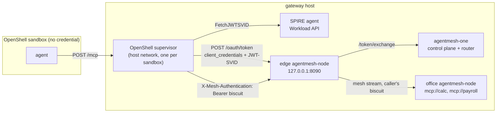

This guide puts an agent that runs in an [NVIDIA OpenShell](https://github.com/NVIDIA/OpenShell)
sandbox on the mesh under the sandbox's own identity. The sandbox holds no
credential. The OpenShell supervisor outside the sandbox proves who the
sandbox is with a SPIFFE JWT-SVID, the mesh turns that proof into a
credential with the roles your policy binds to that identity, and the
supervisor attaches the credential to every request the sandbox makes to
the mesh. Revoking a sandbox is a policy change; no token has to be
rotated and nothing in the sandbox has to change.

Nothing here modifies OpenShell. The release images and the `openshell` CLI
are used as published; the integration is one configuration line in the
gateway and one provider profile.

The whole setup runs on one Linux machine with Docker:
[`development/examples/openshell-sandbox/`](https://github.com/google/agentmesh/tree/main/development/examples/openshell-sandbox)
in the repository has the Compose project and a Makefile for every step
below.

## How the pieces fit



1. The agent sends a plain MCP request to `host.openshell.internal:8090`. It
   does not know about the mesh credential.
2. The supervisor applies the sandbox's network policy. The request matches
   the `agentmesh` provider, whose credential is a token grant, so the
   supervisor asks the SPIRE agent for a JWT-SVID. The SPIRE agent attests
   the supervisor by the labels on its container and answers with the SPIFFE
   ID registered for that sandbox name.
3. The supervisor posts the JWT-SVID to the edge node's token endpoint as an
   RFC 7523 client assertion (`grant_type=client_credentials`). The node
   exchanges it at the control plane, which verifies the SVID against SPIRE's
   OIDC discovery document and mints a Biscuit carrying the roles bound to
   `user:spiffe://openshell.local/sandbox/<name>`.
4. The supervisor caches the Biscuit and injects it as
   `X-Mesh-Authentication: Bearer …` on this and later requests. The edge node
   forwards the request into the mesh under that identity, and the office
   node enforces the policy on its side.

## Before you start

- Docker Engine with the Compose plugin, running as root (the OpenShell
  gateway keeps its state in `/var/lib/openshell`).
- The `openshell` CLI, 0.1.3 or later, from the
  [OpenShell installation page](https://docs.openshell.ai/about/installation).
- `agentmesh-one` and `agentmesh-node` images newer than v0.1.0-rc.9, which
  is when the node's token endpoint learned the client assertion grant. The
  Compose project uses the `latest` images; set `AGENTMESH_VERSION` to pin a
  release.
- `python3` and `curl`.

```bash
cd development/examples/openshell-sandbox
```

## 1. Identity: SPIRE for the sandboxes

Three SPIRE containers give the gateway host a trust domain,
`openshell.local`:

- `spire-server`, with `jwt_issuer = "http://spire-oidc:8008"` so every
  JWT-SVID names the issuer the mesh will trust.
- `spire-oidc`, the SPIRE OIDC Discovery Provider, publishing the trust
  domain's JWT keys at `http://spire-oidc:8008/.well-known/openid-configuration`
  on the Compose network. Plain HTTP is fine there; in production put it
  behind TLS.
- `spire-agent`, serving the Workload API on
  `/var/lib/openshell/spire-agent/agent.sock` and attesting callers with
  the `docker` workload attestor. It runs in the host PID namespace and reads
  the Docker socket so it can map a caller back to its container.

OpenShell labels every supervisor container with
`openshell.ai/sandbox-name=<name>`, so one registration entry per sandbox
gives it its own SPIFFE ID:

```bash
spire-server entry create \
  -parentID spiffe://openshell.local/host \
  -spiffeID spiffe://openshell.local/sandbox/demo \
  -selector docker:label:openshell.ai/sandbox-name:demo
```

`make sandbox NAME=demo` runs this before it creates the sandbox.

## 2. The mesh: trust SPIRE as a workload issuer

`agentmesh-one` starts with two extra flags:

```text
--workload-issuer=http://spire-oidc:8008
--allowed-audiences=agentmesh
```

A JWT-SVID from that issuer with `aud: agentmesh` is now a workload identity
the control plane accepts at `/token/exchange`, which is how the edge node
turns it into a Biscuit. The policy binds the sandbox identity to a role:

```json
{
  "roles": [
    { "name": "sandbox",
      "allowed_services": ["system://mesh.catalog", "mcp://calc"],
      "allowed_targets": ["*"] }
  ],
  "bindings": [
    { "role": "sandbox", "members": ["user:spiffe://openshell.local/sandbox/demo"] }
  ]
}
```

`system://mesh.catalog` lets the role list tools; `mcp://calc` lets it call
them. The office node publishes the same calculator twice, as `mcp://calc`
and `mcp://payroll`, so the policy has something to refuse.

Two nodes join with the standing join token: the `edge-node` beside the
sandboxes, whose API Compose publishes on `127.0.0.1:8090`, and the
`office-node`, which fronts the calculator. The edge node declares no
services; it is the sandboxes' door to the mesh.

## 3. OpenShell: one line and one profile

The gateway runs from `deploy/docker/docker-compose.yml` of the OpenShell
release, with one line added to `gateway.toml`:

```toml
[openshell.drivers.docker]
provider_spiffe_workload_api_socket = "/var/lib/openshell/spire-agent/agent.sock"
```

The gateway projects that socket into every sandbox supervisor it starts.
The supervisor runs on the host network, so the token endpoint below is the
edge node's published port on loopback, which is the form OpenShell accepts
for a plaintext token endpoint.

The provider profile declares the credential as a token grant and names the
endpoints it applies to:

```yaml
id: agentmesh
credentials:
  - name: mesh_token
    auth_style: bearer
    header_name: X-Mesh-Authentication
    token_grant:
      grant_type: client_credentials
      token_endpoint: http://127.0.0.1:8090/oauth/token
      jwt_svid_audience: agentmesh
      client_assertion_type: urn:ietf:params:oauth:client-assertion-type:jwt-spiffe
      cache_ttl_seconds: 60
endpoints:
  - host: host.openshell.internal
    port: 8090
    path: /mcp
    protocol: mcp
    enforcement: enforce
    mcp:
      allow_all_known_mcp_methods: true
    rules:
      - allow: {}
  - host: host.openshell.internal
    port: 8090
    path: /v1/**
    protocol: rest
    access: read-write
    enforcement: enforce
```

`jwt_svid_audience` is the `aud` the supervisor asks SPIRE for, and must be
one the control plane allows. `cache_ttl_seconds` is how long the supervisor
keeps a Biscuit before it trades a fresh SVID for a new one, so it is also
how long a policy change takes to reach a running sandbox. The `/mcp`
endpoint uses OpenShell's MCP inspection; the `/v1/**` endpoint is the
node's OpenAI-compatible API for models published on the mesh.

Register the gateway and the provider once:

```bash
openshell gateway add http://127.0.0.1:8080 --name openshell-agentmesh
openshell profile import -f openshell/provider-profile.yaml
openshell provider create --name agentmesh --type agentmesh --runtime-credentials
```

`--runtime-credentials` records that this provider stores nothing: the
credential is resolved at runtime, per sandbox. `make up` does all of this.

## 4. A sandbox on the mesh

```bash
make sandbox NAME=demo
```

creates the SPIRE entry, waits for the agent to pick it up, and runs

```bash
openshell sandbox create --name demo --from openshell-agentmesh-sandbox:local \
  --provider agentmesh --detach -- sleep infinity
```

The image is Ubuntu with `curl`; an agent image takes its place. Now call
the mesh from inside the sandbox:

```bash
make call NAME=demo
```

```text
== tools the mesh offers sandbox demo
  12D3KooWNmsppgKL…  mcp://calc/add           Return a + b.
  12D3KooWNmsppgKL…  mcp://calc/multiply      Return a * b.
== mcp://calc, allowed for the sandbox role
mcp://calc/add(2, 3) = 5.0
== mcp://payroll, not in the sandbox role
  (no tool of mcp://payroll is visible to this sandbox; calling the office node directly)
mcp://payroll/add(2, 3) -> refused: auth rejected by 12D3KooWNmsppgKL…: biscuit: denied by no matching policies
```

Each line is an `openshell sandbox exec … curl` against
`http://host.openshell.internal:8090/mcp` with no credential in the
request. `find_remote_tools` lists only what the policy allows the caller to
see, so `mcp://payroll` is absent; asking the office node for it by name is
refused there, by the office node, with the sandbox's own Biscuit as the
evidence. The control plane log shows the exchange that produced that
Biscuit:

```text
Border Crossing {"endpoint": "/token/exchange", "decision": "allow",
  "subject": "spiffe://openshell.local/sandbox/demo", "roles": ["sandbox"]}
```

## 5. Same image, same profile, different identity

```bash
make rogue
```

creates a second sandbox, `rogue`, with its own SPIRE entry but no binding in
the policy. Its supervisor gets a JWT-SVID and a Biscuit the same way, and
the Biscuit carries no roles:

```text
== tools the mesh offers sandbox rogue
== mcp://calc, allowed for the sandbox role
mcp://calc/add(2, 3) -> refused: the mesh shows this sandbox no MCP provider at all (no role binds its identity)
```

To let it in, add `user:spiffe://openshell.local/sandbox/rogue` to the
`sandbox` role's members in `policy.json` and push the policy:

```bash
make policy
make call NAME=rogue
```

The running sandbox is allowed within a minute, once the supervisor's cached
Biscuit expires and it exchanges a fresh SVID. Removing the member again
revokes the sandbox the same way. Neither step touches the sandbox, the
gateway, or any token.

## Using it with an agent

An agent in the sandbox sees the mesh as an ordinary MCP server at
`http://host.openshell.internal:8090/mcp` with no authentication, because
the supervisor adds it. Create the sandbox from your agent image with
`--provider agentmesh`, then register that URL with the agent's MCP client,
for example `claude mcp add --transport http mesh
http://host.openshell.internal:8090/mcp` for Claude Code. Models published
on the mesh are available the same way through
`http://host.openshell.internal:8090/v1`, the node's OpenAI-compatible API.

## What to change for a real deployment

- Register one SPIRE entry per sandbox from the system that creates the
  sandbox, as `make sandbox` does here, or bind on a broader selector such as
  `docker:label:openshell.ai/sandbox-namespace:<team>` and give the role to
  every sandbox in that namespace.
- Serve the OIDC discovery provider over TLS and point `--workload-issuer`
  at that URL; the `jwt_issuer` in `server.conf` must match it exactly.
- Keep the edge node on the gateway host. OpenShell accepts a plaintext
  token endpoint only on loopback or at a Kubernetes service name; anywhere
  else the node's API needs `--tls-cert` and `--tls-key` and the supervisor
  must trust that certificate.
- On Kubernetes, OpenShell's Helm chart mounts the SPIFFE CSI socket with
  `provider_spiffe_workload_api_socket_path`, and SPIRE's Kubernetes
  workload attestor replaces the Docker labels. The profile and the policy
  stay the same.

## Cleaning up

```bash
make down
```

removes the sandboxes, the provider and profile, the gateway registration,
and the Compose project. OpenShell's state under `/var/lib/openshell` stays.
