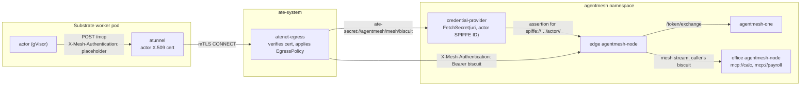

This guide puts an [Agent Substrate](https://github.com/agent-substrate/substrate)
actor on the mesh under its own identity. Substrate runs agents as actors in
gVisor sandboxes and sends all of their outbound traffic through an egress
gateway that authenticates each actor by certificate and enforces a
per-actor `EgressPolicy`. That gateway can also replace a request header
with a credential it fetches from a credential provider. This guide adds an
Agent Mesh credential provider: for each actor, it asserts the actor's
SPIFFE ID to the mesh and hands the gateway the credential the mesh mints
for it. The actor holds nothing and sends a placeholder; the mesh policy
decides what each actor identity may call, and revoking an actor is a policy
change.

Nothing here modifies Substrate. The provider implements Substrate's
`CredentialProvider` gRPC contract and is registered with the installer flag
Substrate already has for that.

Everything runs on one kind cluster:
[`development/examples/substrate-actor/`](https://github.com/google/agentmesh/tree/main/development/examples/substrate-actor)
in the repository has the provider, the manifests and a Makefile for every
step below.

## How the pieces fit



1. The actor sends a plain MCP request to
   `edge-node.agentmesh.svc.cluster.local:8080` with
   `X-Mesh-Authentication: Bearer placeholder`. Substrate's `atunnel` carries
   it to the egress gateway over mTLS with the actor's certificate.
2. The gateway verifies the certificate, finds the matching `EgressPolicy`
   rule, and because the request carries the header the rule names, asks the
   credential provider for `ate-secret://agentmesh/mesh/biscuit` on behalf of
   `spiffe://substrate-actor.local/actor/<atespace>/<name>`. The gateway
   authenticates to the provider with its pod certificate; the provider
   accepts no other caller.
3. The provider signs a short-lived assertion whose subject is that SPIFFE
   ID and exchanges it at the edge node's token endpoint (RFC 8693). The
   control plane verifies the assertion against the provider's published
   keys, since the provider is configured as a workload identity issuer, and
   mints a Biscuit with the roles bound to that subject. The provider caches
   it per actor.
4. The gateway replaces the header value with `Bearer <biscuit>` and forwards
   the request. The edge node passes the request into the mesh under that
   identity, and the office node enforces the policy on its side.

The provider is the attester here: the mesh trusts it to name actors
truthfully, and it names only what the egress gateway, which verified the
certificate, told it. Once Substrate serves OpenID discovery for the actor
JWTs it already mints
([agent-substrate/substrate#1756](https://github.com/agent-substrate/substrate/issues/1756)),
the provider becomes unnecessary: the gateway's `actorJwt` injection puts a
Substrate-signed JWT on the header, and `agentmesh-one` trusts Substrate's
issuer directly. The last section shows that change.

## Before you start

- Docker, kind, ko, kubectl, Go and python3.
- A checkout of Agent Substrate; the example installs it from source with
  Substrate's own scripts.
- `agentmesh-one` and `agentmesh-node` images at `v0.1.0` or newer. The
  Makefile defaults to `v0.1.1`; set `AGENTMESH_VERSION` for another release.

```bash
cd development/examples/substrate-actor
```

## 1. Substrate, with the gateway pointed at the provider

```bash
make cluster SUBSTRATE_DIR=~/src/substrate
```

creates the kind cluster with Substrate's `hack/create-kind-cluster.sh` and
installs Substrate with

```bash
./hack/install-ate-kind.sh --deploy-ate-system --deploy-demo-sandbox \
  --credential-provider='{"name":"agentmesh","address":"credential-provider.agentmesh.svc:50051"}'
```

`--credential-provider` is the installer's existing option for a provider you
deploy yourself. `name` becomes the provider class of the credential URIs
(`ate-secret://agentmesh/...`) and `address` is where the egress gateway dials
it. The gateway presents its pod-identity certificate and verifies the
provider's serving certificate against the cluster's servicedns trust bundle,
so the provider's Service must exist before Substrate starts; the Makefile
creates the `agentmesh` namespace and the Service first.

`--deploy-demo-sandbox` installs Substrate's sandbox demo: an Alpine actor
whose `POST /process` runs a command inside the sandbox. It stands in for an
agent; any image that speaks HTTP takes its place.

## 2. The provider and the mesh

```bash
make up
```

builds the provider with `ko`, loads the calculator image into kind, and
applies `manifests/`. The provider runs with the same two projected volumes
as Substrate's bundled Kubernetes Secrets provider:

```yaml
args:
- --server-cred-bundle=/run/servicedns.podcert.ate.dev/credential-bundle.pem
- --client-ca-file=/run/podidentity.podcert.ate.dev/trust-bundle.pem
- --injector-identity=spiffe://cluster.local/ns/ate-system/sa/atenet-egress
- --node-url=http://edge-node.agentmesh.svc.cluster.local:8080
- --issuer=http://credential-provider.agentmesh.svc.cluster.local:8080
- --audience=agentmesh
- --cache-ttl=60s
```

`--issuer` is the `iss` of the assertions the provider signs; it serves the
matching discovery document and JWKS on its HTTP port. `agentmesh-one` names
the same URL:

```text
--workload-issuer=http://credential-provider.agentmesh.svc.cluster.local:8080
--allowed-audiences=agentmesh
```

The mesh policy in `manifests/mesh.yaml.tmpl` binds the actor's identity to a
role:

```json
{
  "roles": [
    { "name": "actor",
      "allowed_services": ["system://mesh.catalog", "mcp://calc"],
      "allowed_targets": ["*"] }
  ],
  "bindings": [
    { "role": "actor",
      "members": ["user:spiffe://substrate-actor.local/actor/ate-demo-sandbox/demo"] }
  ]
}
```

The subject is the SPIFFE ID Substrate gives the actor: trust domain
`substrate-actor.local`, then `actor/<atespace>/<name>`. The office node
publishes the calculator twice, as `mcp://calc` and `mcp://payroll`, so the
policy has something to refuse.

## 3. The actor's egress policy

```bash
make actor NAME=demo
```

creates the actor from the demo template and gives it this `EgressPolicy`:

```yaml
rules:
- http:
    hostnames: ["edge-node.agentmesh.svc.cluster.local"]
    ports:
      numbers: [8080]
    effects:
      replaceHeaders:
      - header: X-Mesh-Authentication
        prefix: "Bearer "
        credentialUri: ate-secret://agentmesh/mesh/biscuit
```

One host, one port, and the rule the gateway applies to it. A request without
the header is forwarded unchanged, so the actor opts in by sending the
placeholder; a request to any other destination is refused by the gateway
before it leaves the cluster.

## 4. Calling the mesh from the actor

```bash
make call NAME=demo
```

```text
== tools the mesh offers actor demo
  12D3KooWMaj9ere9…  mcp://calc/add           Return a + b.
  12D3KooWMaj9ere9…  mcp://calc/multiply      Return a * b.
== mcp://calc, allowed for the actor role
mcp://calc/add(2, 3) = 5.0
== mcp://payroll, not in the actor role
  (no tool of mcp://payroll is visible to this actor; calling the office node directly)
mcp://payroll/add(2, 3) -> refused: auth rejected by 12D3KooWMaj9ere9…: biscuit: denied by no matching policies
```

Each line is a `wget` run inside the actor through Substrate's ingress
router (`ate-target-actor: ate-demo-sandbox/demo`). The egress gateway's
access log shows the actor's certificate and the request it allowed; the
provider logs one mint per actor and serves the rest from its cache; the
control plane logs the exchange that produced the credential:

```text
Border Crossing {"endpoint": "/token/exchange", "decision": "allow",
  "subject": "spiffe://substrate-actor.local/actor/ate-demo-sandbox/demo", "roles": ["actor"]}
```

## 5. Same template, same policy, different identity

```bash
make rogue
```

creates a second actor, `rogue`, from the same template with the same egress
policy. The gateway fetches a credential for
`spiffe://substrate-actor.local/actor/ate-demo-sandbox/rogue`, the mesh mints
one with no roles, and the office node shows it nothing:

```text
== tools the mesh offers actor rogue
== mcp://calc, allowed for the actor role
mcp://calc/add(2, 3) -> refused: the mesh shows this actor no MCP provider at all (no role binds its identity)
```

Add `user:spiffe://substrate-actor.local/actor/ate-demo-sandbox/rogue` to the
`actor` role's members in `manifests/mesh.yaml.tmpl`, apply the ConfigMap,
and push the policy:

```bash
make policy
make call NAME=rogue
```

The running actor is allowed on its next request; an actor that already held
a credential changes within `--cache-ttl`. Removing the member revokes it the
same way. Neither step touches the actor, its template, or Substrate.

## When Substrate serves its own issuer

Substrate's egress gateway can already mint and inject a JWT for the calling
actor (`actorJwt` in `replaceHeaders`), signed by the control plane with
`iss` set to Substrate's `--actor-jwt-issuer`. What is missing today is a
server for that issuer's discovery document and keys; it is tracked in
[agent-substrate/substrate#1756](https://github.com/agent-substrate/substrate/issues/1756).
When it lands, the provider goes away and two things change:

```yaml
# EgressPolicy
      replaceHeaders:
      - header: X-Mesh-Authentication
        prefix: "Bearer "
        actorJwt: {audiences: ["agentmesh"], expirationSeconds: 600}
```

```text
# agentmesh-one
--workload-issuer=https://idp.ate-system.svc
```

The mesh policy keeps the same subjects. The edge node exchanges the actor
JWT on each request the way it exchanges any platform JWT.

## Cleaning up

```bash
make down    # the actors and the agentmesh namespace
make clean   # the kind cluster
```
