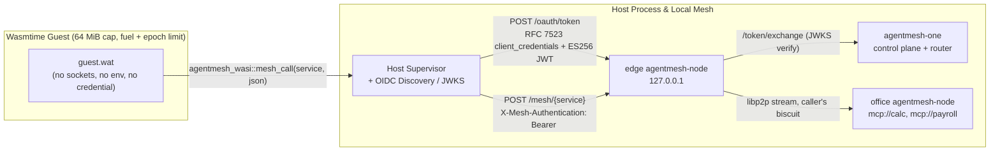

This guide puts an agent or tool plugin that runs in a capability-based
[Wasmtime](https://github.com/bytecodealliance/wasmtime) WebAssembly sandbox on
the mesh under its own identity. The Wasm guest holds no credential, has no
ambient network stack (`wasi:sockets` omitted), and mounts no host filesystem or
environment variables. Instead, the guest passes a logical service URI
(`mcp://calc`) and JSON payload to a single host import
(`agentmesh_wasi::mesh_call`). Outside Wasm linear memory, the host supervisor
mints a short-lived workload JWT for that sandbox's SPIFFE ID, trades it at the
local `agentmesh-node` (`POST /oauth/token`) for a Biscuit carrying the roles
bound to that identity, and attaches the Biscuit when forwarding the call into
the mesh.

Because any language that compiles to a Wasm or WASI module (Python,
TypeScript, Go, Rust) can target the same narrow host import without embedding
mesh SDKs or holding credentials, the same topology runs identically on a
developer laptop (Linux, macOS, Windows), an on-premises server, or an edge
node — without Docker Desktop, Kubernetes CRDs, or container CNI plugins.

Everything runs on one machine with a Rust toolchain:
[`development/examples/wasmtime-sandbox/`](https://github.com/google/agentmesh/tree/main/development/examples/wasmtime-sandbox)
in the repository has the WebAssembly text guest (`guest.wat`), the Rust host
supervisor, the mesh policy, and a Makefile for every step below.

## How the pieces fit



1. The Wasm guest calls `agentmesh_wasi::mesh_call("mcp://calc", payload)`. Its
   linear memory contains only the request JSON and receives only the response
   body; neither the signing key, the workload JWT, nor the exchanged Biscuit
   is ever written into guest memory.
2. The host supervisor identifies which sandbox instance invoked the host
   import (`spiffe://agentmesh.local/wasm/<name>/epoch/<epoch>`) and signs a
   short-lived ES256 (P-256) JWT with `aud: agentmesh`.
3. The supervisor posts that JWT to the local edge node's `POST /oauth/token`
   endpoint using an RFC 7523 `client_credentials` assertion (or RFC 8693
   `urn:ietf:params:oauth:grant-type:token-exchange`). The edge node exchanges
   it at `agentmesh-one`, which verifies the signature against the supervisor's
   OIDC discovery and JWKS endpoints and mints a Biscuit carrying the roles
   bound to that subject.
4. The supervisor forwards the payload to `POST /mesh/mcp://calc` on the edge
   node with `X-Mesh-Authentication: Bearer <biscuit>`. The office node
   verifies the Biscuit against the standing Datalog policy before reaching the
   upstream handler.

## Before you start

- A Rust toolchain (`cargo` and `rustc` 1.80 or newer).
- `agentmesh-one` and `agentmesh-node` binaries at `v0.2.0` or newer. If they
  are not already in `../../bin` or `PATH`, `./run.sh` downloads the official
  release archive for your OS and architecture and verifies its SHA-256 digest
  against `checksums.txt`.
- `curl` (and `make` if you use the Makefile targets).

```bash
cd development/examples/wasmtime-sandbox
```

## 1. The Wasm guest boundary

The guest module in `guest.wat` imports four host functions in the
`agentmesh_wasi` namespace and exports `run_mesh_call` and `infinite_spin`:

```wat
(module
  (import "agentmesh_wasi" "input_len" (func $input_len (result i32)))
  (import "agentmesh_wasi" "read_input" (func $read_input (param i32 i32) (result i32)))
  (import "agentmesh_wasi" "emit_output" (func $emit_output (param i32 i32) (result i32)))
  (import "agentmesh_wasi" "mesh_call"
    (func $mesh_call (param i32 i32 i32 i32 i32 i32) (result i32)))
  (memory (export "memory") 1 16)
  ;; ...
)
```

The host supervisor instantiates each sandbox with four resource and capability
controls:

- **No ambient WASI capabilities**: `wasmtime::Linker` registers only the four
  `agentmesh_wasi` functions above — no `wasi:sockets`, filesystem directories,
  or host environment variables.
- **Bounded linear memory**: `StoreLimitsBuilder::new().memory_size(64 * 1024 * 1024)`
  caps each sandbox store at 64 MiB.
- **Deterministic fuel + epoch preemption**: `Config::consume_fuel(true)` and
  `Config::epoch_interruption(true)` bound CPU execution so a runaway loop
  (`infinite_spin`) traps deterministically without starving the host.
- **Monotonic epoch subjects**: Each sandbox's workload subject encodes an
  integer generation epoch (`spiffe://agentmesh.local/wasm/<name>/epoch/<epoch>`),
  allowing the supervisor to invalidate a compromised instance by incrementing
  its epoch.

## 2. The mesh: trust the supervisor as a workload issuer

`agentmesh-one` starts with the supervisor's loopback OIDC discovery URL and
the initial `policy.json`:

```text
--workload-issuer=http://127.0.0.1:<oidc-port>
--allowed-audiences=agentmesh
--policy-file=policy.json
--admin-token-path=run/admin-token
--join-token-path=run/join-token
```

The policy in `policy.json` binds two sandbox identities (`demo` and `ledger`)
to distinct roles:

```json
{
  "roles": [
    {
      "name": "sandbox",
      "allowed_services": ["system://mesh.catalog", "mcp://calc", "mcp://echo-headers"],
      "allowed_targets": ["*"]
    },
    {
      "name": "ledger",
      "allowed_services": ["system://mesh.catalog", "mcp://payroll"],
      "allowed_targets": ["*"]
    }
  ],
  "bindings": [
    {
      "role": "sandbox",
      "members": ["user:spiffe://agentmesh.local/wasm/demo/epoch/*"]
    },
    {
      "role": "ledger",
      "members": ["user:spiffe://agentmesh.local/wasm/ledger/epoch/*"]
    }
  ]
}
```

The office node publishes three loopback services — `mcp://calc`,
`mcp://payroll`, and `mcp://echo-headers` — while the edge node declares no
services and acts as the host supervisor's local entry point to the mesh.

## 3. Running a sandbox on the mesh

Start the topology in the background:

```bash
make up
```

Now invoke the mesh from inside the `demo` Wasm sandbox:

```bash
make call NAME=demo
```

```text
== tools the mesh offers sandbox demo
  12D3KooWDcrR9Fqg...  mcp://calc               calculator MCP server in the office
  12D3KooWDcrR9Fqg...  mcp://payroll            restricted payroll MCP server the sandbox role may not call
  12D3KooWDcrR9Fqg...  mcp://echo-headers       header echo MCP server verifying credential stripping and X-Mesh-Principal
== mcp://calc, allowed for the sandbox role
mcp://calc/add(2, 3) = 5.0  [wasm linear memory: 0 JWT/Biscuit bytes]
== mcp://payroll, not in the sandbox role
mcp://payroll/add(2, 3) -> refused: auth rejected by office-node (HTTP 403 -> WASI_ERR_ACCESS_DENIED = -5)
```

Both calls execute the same compiled `guest.wat` module inside Wasmtime. For
`mcp://calc`, the office node authorizes the Biscuit minted for
`spiffe://agentmesh.local/wasm/demo/epoch/0` and returns `5.0`. For
`mcp://payroll`, the office node rejects the call because the `sandbox` role
does not grant `mcp://payroll`.

## 4. Same Wasm module, different identity

```bash
make rogue
```

runs the exact same `guest.wat` binary under the `rogue` sandbox identity
(`spiffe://agentmesh.local/wasm/rogue/epoch/0`), which has no role binding in
`policy.json`:

```text
== rogue has a SPIFFE ID (spiffe://agentmesh.local/wasm/rogue/epoch/0) but policy.json binds it to no role
== tools the mesh offers sandbox rogue
== mcp://calc, allowed for the sandbox role
mcp://calc/add(2, 3) -> refused: the mesh shows sandbox 'rogue' no MCP provider (no role binds its identity)
```

To grant `rogue` access to `mcp://calc`, add
`user:spiffe://agentmesh.local/wasm/rogue/epoch/*` to the `sandbox` role in
`policy.json` and push the updated policy:

```bash
make policy
make call NAME=rogue
```

The next call from `rogue` succeeds immediately without recompiling the Wasm
module or restarting any node.

## 5. Automated isolation and containment check

Run the end-to-end verification suite with `make check` (or `./run.sh check`
for a self-contained single-command run):

```bash
./run.sh check
```

```text
  [PASS] Case 1: Wasm `demo` -> libp2p -> `mcp://calc` => 42.0 (0 JWT/Biscuit bytes in Wasm linear memory)
  [PASS] Case 2: Caller `Authorization`/`Cookie`/`X-Mesh-*` stripped; backend received `X-Mesh-Principal: spiffe://agentmesh.local/wasm/demo/epoch/0`
  [PASS] Case 3: Denied service (`demo -> mcp://payroll`) refused by office-node (HTTP 403 -> Wasm -5)
  [PASS] Case 4: Role & sibling isolation (`ledger` -> payroll 200 / calc 403; unbound `rogue` -> calc 403)
  [PASS] Case 5: Sealed task Biscuit (`scope=mcp://calc&seal=true`) allowed `mcp://calc` (200) and refused `mcp://echo-headers` (403)
  [PASS] Case 6: Wrong `aud`, wrong `iss`, and expired `exp` JWTs rejected at `/oauth/token`; fresh JWT recovered (200)
  [PASS] Case 7: RFC 7009 `POST /oauth/revoke` immediately blocked Biscuit replay (HTTP 403)
  [PASS] Case 8: `Engine::increment_epoch()` trapped infinite-loop Wasm guest & purged host cache (purge 8 us, total 642 us)
```

In addition to role isolation across `demo`, `ledger`, and `rogue`, the suite
verifies that:

- the office node strips `X-Mesh-Authentication`, `Authorization`, and `Cookie`
  before delivering the request to the upstream backend (`mcp://echo-headers`)
  and injects the verified `X-Mesh-Principal`;
- neither the Biscuit nor the JWT appears anywhere inside the Wasm guest's
  linear memory;
- task-scoped sealed Biscuits (`scope=mcp://calc&seal=true`) and RFC 7009 token
  revocation (`POST /oauth/revoke`) are enforced by the mesh nodes; and
- a non-cooperative infinite loop in the guest (`infinite_spin`) is preempted in
  under 1 millisecond when `Engine::increment_epoch()` fires, while the host
  evicts that sandbox's cached credentials.

## What to change for a real deployment

- **Serve OIDC discovery over TLS**: `agentmesh-one` accepts plain `http://`
  for `--workload-issuer` only on loopback (`127.0.0.1`, `localhost`, `::1`).
  When `agentmesh-one` runs on another host or cluster, front the supervisor's
  OIDC discovery endpoint with HTTPS (or mint workload JWT-SVIDs from SPIRE as
  in the [OpenShell guide](../openshell/)).
- **Cache exchanged Biscuits per `(sandbox, epoch)`**: The example exchanges a
  fresh JWT on each call so policy changes take effect immediately during
  testing. Production supervisors should cache each sandbox's Biscuit until
  shortly before expiry and evict the cache entry when incrementing the
  sandbox's epoch.
- **Use WASI Preview 2 components for multi-language guests**: Replace the
  low-level `(ptr, len)` host import with a WIT interface (`package
  agentmesh:wasi; interface mesh { call: func(service: string, payload: list<u8>)
  -> result<list<u8>, string>; }`) so Python (`componentize-py`), TypeScript
  (`jco`), Go (`tinygo`), and Rust (`wit-bindgen`) guests share one typed host
  binding.

## Cleaning up

```bash
make down
```

stops the background supervisor, `agentmesh-one`, and both `agentmesh-node`
processes and removes `run/`.
